# HATS — Home Assistant Theme Studio

A panel for the Home Assistant sidebar for building a complete theme visually —
built on the colour layer of HA 2026 rather than on the classic individual
variables.

**Status: 0.2.0b5, work in progress.** HATS reads and writes themes, ships a
kit of ready-made parts and a control card for dashboards. It is not released
yet.

## What this is about

Since 2026, Home Assistant computes its interface from a colour layer of its
own: six roles (`primary`, `neutral`, `success`, `warning`, `danger`,
`disabled`), three loudness levels (`quiet`, `normal`, `loud`) and three states
(`resting`, `hover`, `active`). **15 decisions** produce 51 fill colours and 19
text colours.

HATS builds on exactly that. The guiding rule: **only change what you can see.**

And because Bubble Card and Mushroom can read their variables from the same
layer, one assignment covers light and dark at once — no UI eXtension, no CSS
rules, no shadow DOM paths. CSS variables inherit through every shadow boundary;
measured, a value set on `html` arrives twelve levels deep.

What comes out at the end is an ordinary theme file.

## Relationship to HATG

[HATG](https://github.com/Piranha1605/ha-theme-generator) stays in service and
continues to be maintained. HATS does not replace it — it is a second, simpler
route, deliberately in its own repository with its own integration domain so
both can be installed side by side.

One rule when running both: **a theme belongs to one tool.** A HATS theme
survives HATG's import intact — every reference stays verbatim — but HATG adds
its own defaults. Don't edit the same file in both.

The measured knowledge about Home Assistant, Bubble Card and Mushroom lives in
HATG's `CLAUDE.md` and in `docs/uebergabe-neues-projekt.md`. HATS builds on it
instead of working it out again.

## What comes out of it

The same view, the same window size, the same cards — only the theme changes.
Three pictures, not two: without the middle one you credit the UIX templates
with what the fields did.

**Home Assistant as shipped.**

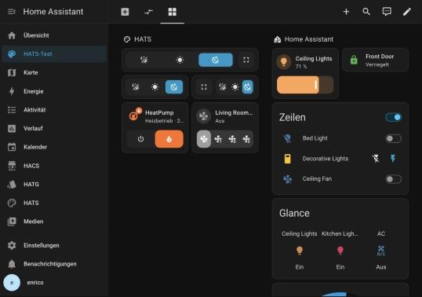

**With a HATS theme — the fields alone.** Apple's system colours, glass on the
cards, corner radii, shadows, a background of four colour islands. This is an
ordinary theme file: no UI eXtension, no CSS rule, no shadow DOM path.

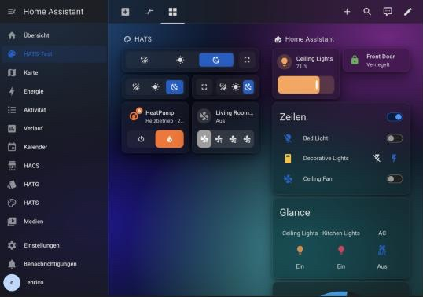

**The same theme with UI eXtension.** The sidebar turns translucent and the
active row into a pill in the accent colour; plus divider lines between the
sections. UIX is the finishing touch — the larger part is already in the
picture before it.

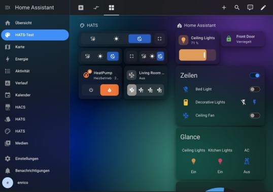

## The kit

If you would rather not start from nothing, you assemble a theme from
ready-made parts: colours, type, corners, density, card style, background. The
fifteen palettes show their colours as beads — the large one at the front is
the accent.

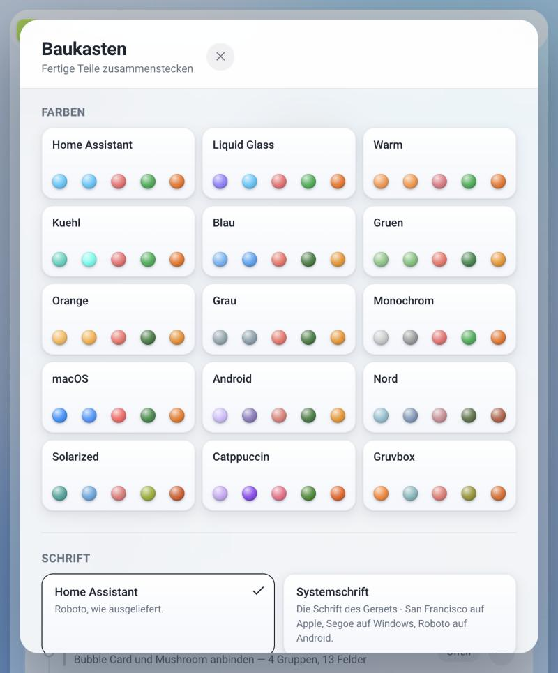

Five of them are **adopted** and verifiable: macOS and Android, plus Nord,
Solarized, Catppuccin and Gruvbox. Apple's values are read from the system
rather than copied from documentation — `werkzeuge/test/macos-farben.swift`
pulls them out of AppKit, and several of the well-known ones have not been
correct since macOS 26.

**Corners** and **Density** set the ladders Home Assistant computes its edges
and spacing from — nine steps from `sm` to `6xl`, twenty from `--ha-space-1` to
`-20`. Four parts each, with Home Assistant's own values as one of them. **Card
style** has seven: Glass, macOS, Embossed, Outline, Flat, Raised, Paper.

The parts recognise themselves in a finished file even when it was not built
with the kit: `werkzeuge/themes/macos.yaml` comes out of a script and still
matches in all six categories.

## The control card

HATS ships a card for dashboards: a bar of buttons. Each one is a target, a
switch or a built-in function — mode, light/dark, fullscreen, weather.

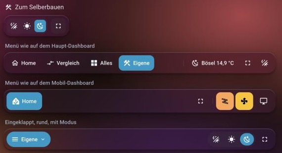
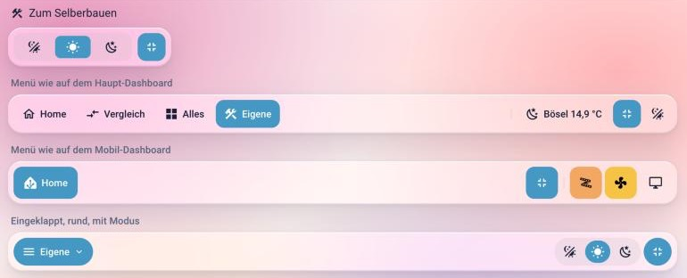

```yaml
type: custom:hats-control-card
buttons:
  - name: Home
    icon: mdi:home-outline
    link: /dashboard-home
  - name: Lights
    icon: mdi:ceiling-light-multiple
    link: /dashboard-home/lights
  - entity: light.kitchen         # lit while the lamp is on
    align_end: true
    separator_before: true
  - function: weather
    entity: weather.forecast_home
    align_end: true
  - function: fullscreen
    align_end: true
  - function: mode
    align_end: true
collapse: narrow
```

Without `buttons` it shows mode and fullscreen — the short form:

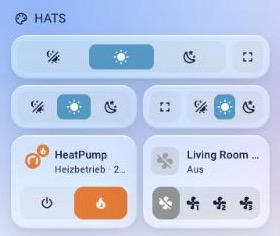
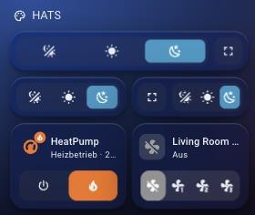

**Buttons**

| Field | |
|---|---|
| `name`, `icon` | label and icon; one of them is enough |
| `link` | a path changes the view. The pill sits on the button whose target is open |
| `entity` | turns the button into a switch: a tap toggles it, and it is lit while the entity is on |
| `tap_action` | any Home Assistant action; it wins over `link` and over toggling |
| `state_background` | default `true`: a button that is on is filled |
| `light_background` | default `true`: in the lamp's colour, otherwise in Home Assistant's state colour |
| `function` | `mode` (auto/light/dark), `theme` (one button, back and forth), `fullscreen`, `weather`, `motion`, `appearance`, `settings`, `sidebar`, `assist`, `edit` |
| `temperature`, `temperature_source` | `weather` only: a sensor of your own, and whether the value comes from it (`sensor`) or from the weather entity (`weather`) |
| `align_end`, `separator_before` | at the end of the bar; a thin line before it |

**The bar**

It appears in the card picker as soon as the integration is set up and the
page has been reloaded once — on the **"By card"** tab, search for "HATS". The
dialog opens on "By entity", and the card is not listed there: it has no
entity.

There is no resource to register. HATS adds the card to the list under
Settings → Dashboards → Resources itself and removes it again when the
integration is removed. Only if you keep your resources in YAML do you add it
by hand; the log shows the line.

| Field | Default | |
|---|---|---|
| `collapse` | `never` | `narrow` or `always`: the targets move into a list under a menu button. If the bar still does not fit, the buttons at the end follow, starting from the right. With `never` the row scrolls sideways instead |
| `collapse_width` | `500` | with `narrow`: below this **card width**, not window width — and whenever the bar does not fit |
| `menu_shape` | `theme` | `pill` for fully round ends |
| `menu_size` | `normal` | `small`, `normal`, `large` |
| `show_highlight` | `true` | the pill on the current view |
| `kiosk_only` | `false` | `true`: fullscreen in Home Assistant only, the browser window stays |
| `replace_header` | `false` | `true`: on this dashboard the bar replaces Home Assistant's header |
| `controls` | `[mode, fullscreen]` | the short form, when there are no `buttons` |

**The background motion** is set by a button with `function: motion`. It
opens four sliders — drift, colour dots, colour shift and range:

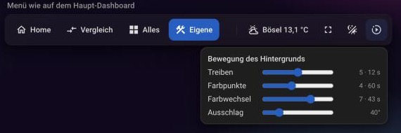

The values are permanent: on release the card writes them into the file of the
active theme, using the same functions as the panel. This works for
administrators only, and only for a theme created with HATS; otherwise the
slider says why not.

**Transparency and text size** are set by a button with `function: appearance`,
the same way and under the same conditions:

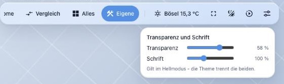

- **Transparency** (0 to 80 %) changes the card surface. If the theme keeps it
  apart for light and dark, the slider applies to the mode currently shown. If
  the surface is not a plain colour — the "Liquid Glass" card style stores two
  gradients — the slider stays locked. The surface of dialogs and of the
  settings window follows by the same step, so it stays as much more opaque
  than the cards as before — at most fully opaque, and never below 50 %
  opacity, so text on it stays readable.
- **Text size** (90 to 120 %) sets the factor Home Assistant uses for all font
  sizes. Tiles and Mushroom grow with it; the names in Bubble Card stay as they
  are. Above 100 %, tiles cut long names short sooner.

Only the value you moved is written.

**Everything in one window** comes with `function: settings`: one button at
the end of the bar, behind it a settings window modelled on the Mac's System
Settings — sections on the left, choices on the right:

| Section | contains |
|---|---|
| Appearance | mode, card style, colour palette, card transparency and blur |
| Background | the kit's gradients and your own images from `config/www/hats` |
| Text and size | size, typeface, corners |
| Motion | drift, colour dots, colour shift, range |
| UIX templates | every template from the panel with a switch, grouped by cards, interface and background — works only with UI eXtension |
| Display | fullscreen, edit dashboard, theme choice, earlier versions |

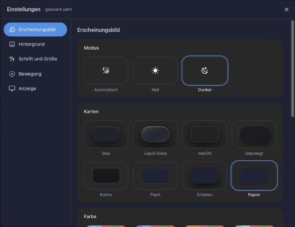

Card styles, palettes, typefaces and backgrounds are the parts of the panel's
kit — the same values, written the same way. The window shows which part is in
place. A click writes into the file of the active theme; the version before is
then listed under "Earlier versions" and is back with one click. On a phone the
window fills the screen.

The single functions stay, for a bar that prefers to show them one by one.

**In place of the header** the bar stands with `replace_header: true`. Home
Assistant's header disappears on the dashboard, the bar stays at the top while
scrolling, and it brings what the header had: a sidebar button and — if there
is no settings window — the pencil for editing. In the settings window the
pencil sits at the far right. Assist is available as `function: assist`.

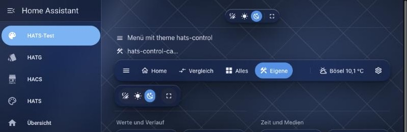

Good to know:

- The bar belongs on **every** view of the dashboard. On a view without it,
  Home Assistant's header is back, so nobody gets stuck.
- In edit mode the header is always there.
- Settings, energy, map and the other pages keep their own header.

The editor lets you add, sort and edit the buttons. Each row shows the
button's name, or without one its target, entity or function:

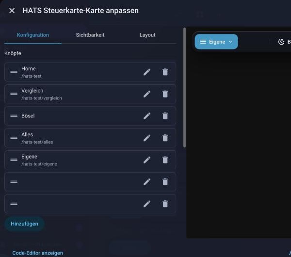

The fields are those of the menu card from the Horizon Cards. A bar from there
keeps working once `type` is `custom:hats-control-card`. Not taken over yet:
`visibility`, `#anchor` links, `hold_action`, `double_tap_action` and
`placement: bottom`.

### As a badge

The same control exists in a small form, for the badge row above the cards:

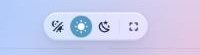
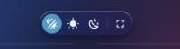

```yaml
type: custom:hats-control-badge
```

The badge is the small control, not the bar: it takes `controls` (`mode`,
`fullscreen`) and `kiosk_only`. Targets, switches and weather belong in the
card. In the badge picker it is listed on the **"By badge"** tab, section
Community badges, as "HATS control":

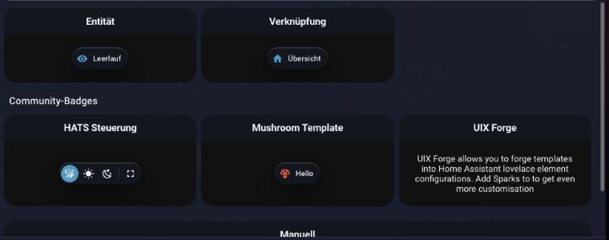

Everything the card uses is provided by Home Assistant: the elements, the
icons, the colour variables and the two switches behind it. It therefore
follows any theme and needs no further card from HACS.

Worth knowing:

- **The mode belongs to the user, not to the device.** Since 2026.10 Home
  Assistant stores the choice with the user on the server. Switching on the
  wall tablet also switches every other device the same user is logged in on.
- **A theme with only one mode cannot be switched.** The card then locks the
  choice and says why when pressed.
- **Fullscreen means three things.** Home Assistant hides the sidebar (its
  kiosk mode), the card takes the header away, and the browser goes fullscreen
  where it offers that. In edit mode the header stays.
- **Fullscreen is remembered per device.** A wall tablet starts in fullscreen
  again after a reload, as soon as the card is on the view. The same button or
  Esc leads back.

## Installation

Not via HACS yet. To try it, copy the `custom_components/hats` folder into
`config/custom_components/`, restart Home Assistant and add the integration
under Settings → Devices & Services.

Requires Home Assistant 2026.10.0 or newer.

## Backups

Before HATS overwrites a theme file — from the panel or from the control
card — it stores the previous version under `config/hats/sicherungen/<name>/`,
with date and time in the name. The last ten per theme are kept. The file is
written to a helper file first and then renamed in one step; if something
breaks off, the old file stays as it was.

## Licence

MIT

---

German version: [README.md](README.md)
