<p align="center">
  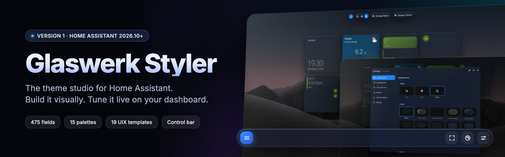
</p>

<p align="center">
  
  
  
  
  
</p>

<p align="center">
  <a href="https://github.com/Piranha1605/glaswerk-styler/blob/main/README.md">Deutsch</a> · <b>English</b>
</p>

<p align="center">
  <a href="https://buymeacoffee.com/enricotenif"></a>
</p>

# Glaswerk Styler

**The theme studio for Home Assistant. Build it visually, tune it live on your dashboard.**

Glaswerk Styler is a panel in your Home Assistant sidebar. It lets you build a complete theme without touching YAML – built on Home Assistant 2026's colour layer. It also brings a control bar for your dashboards: transparency, blur, text size, card style, palette and background are set right where you see them. What you end up with is a plain theme file.

<p align="center">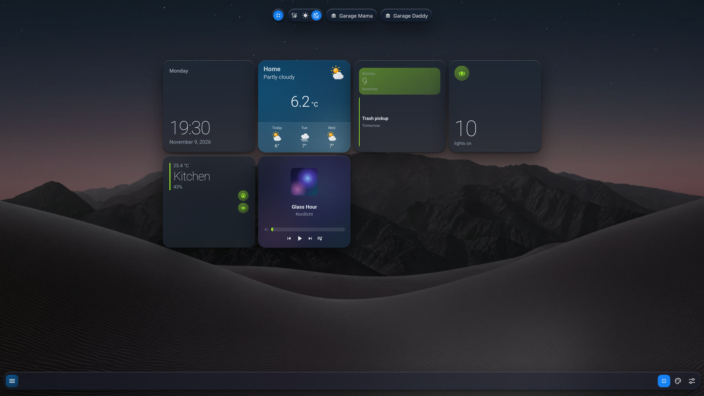</p>

## Video

Glaswerk Styler in 2½ minutes – from the studio to the control bar:

<p align="center"><a href="https://youtu.be/_ZQBg-Uf-2A">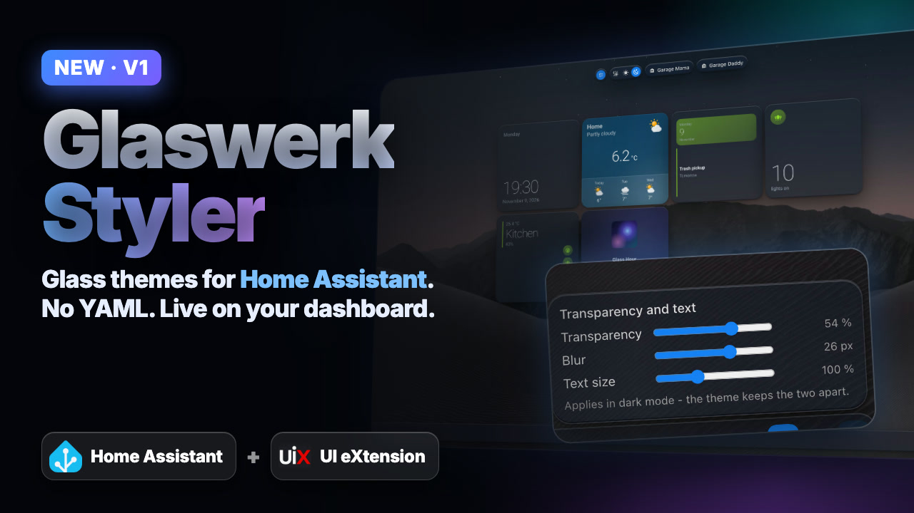</a></p>

## At a glance

| | |
|---|---|
| **Studio** | A sidebar panel: open a theme, change it, save it – 475 fields in eight steps |
| **Kit** | 15 colour palettes, fonts, corners, density, card styles and backgrounds as ready-made parts |
| **Control bar** | One dashboard card: menu, fullscreen, settings window and quick sliders |
| **UIX templates** | 19 templates for UI eXtension with before/after previews |
| **Bubble Card and Mushroom** | read their colours from the same layer – one assignment covers light and dark |
| **Backups** | Every write keeps the previous version, back with one click |

## The studio

The panel reads any existing theme – including foreign ones. Whatever Glaswerk does not know stays untouched in the file. The rule: **only change what you see.** From 15 decisions, Home Assistant derives 51 fill colours and 19 text colours.

<p align="center">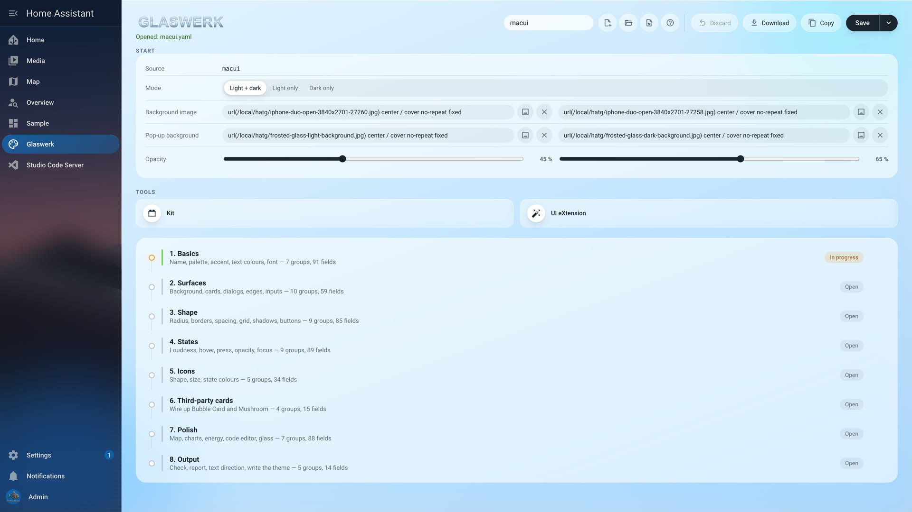</p>

**Kit.** If you don't want to start from scratch, snap a theme together from ready-made parts. Five palettes are adopted and verifiable: macOS (read from the system), Android, Nord, Solarized, Catppuccin and Gruvbox.

<p align="center">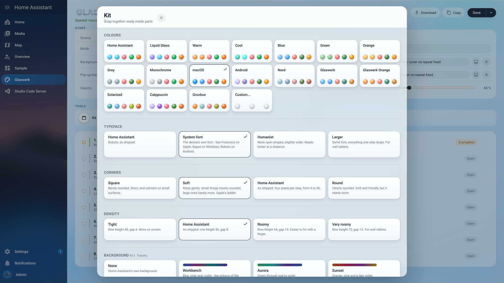</p>

**Eight steps.** Basics, surfaces, shape, states, icons, third-party cards, polish and output – every group with one sentence on what it is for.

<p align="center">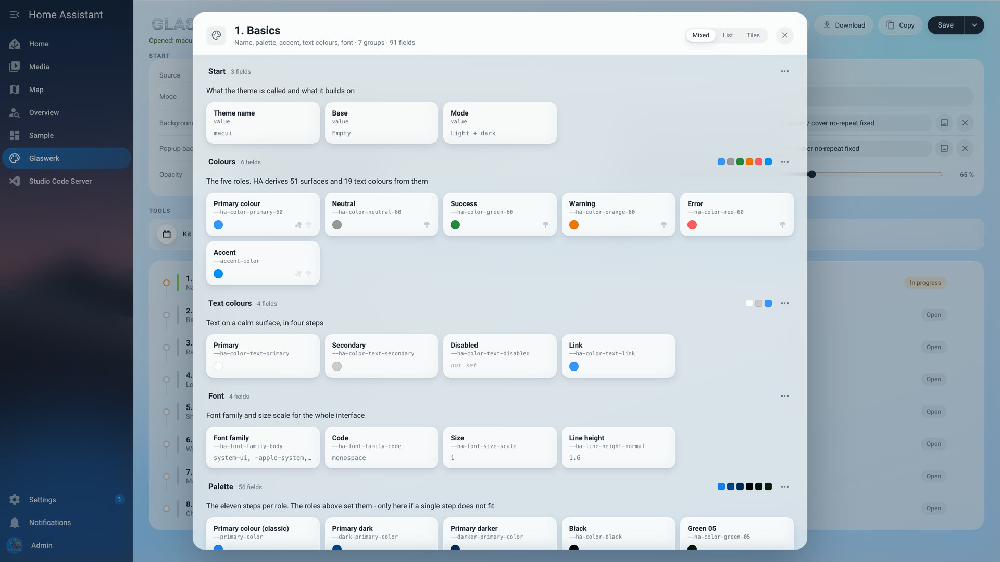</p>

**UI eXtension.** For everything that needs a rule instead of a value: glass on cards, light edge, sidebar in glass, glowing and slimmer sliders. Every template shows before and after in the same spot.

<p align="center">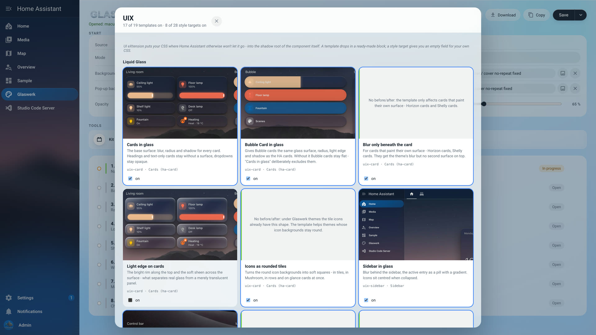</p>

## The control bar

A card for your dashboard. It floats at the bottom edge, and every change goes straight into the theme file.

<p align="center">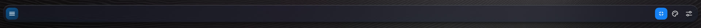</p>

- **Menu** with every view of the dashboard
- **Fullscreen** for wall tablets – remembered per device
- **Quick sliders** for transparency, blur and text size
- **Settings window** modelled on the Mac's System Settings: appearance, background, text and size, motion, UIX templates, display with earlier versions

<p align="center">
  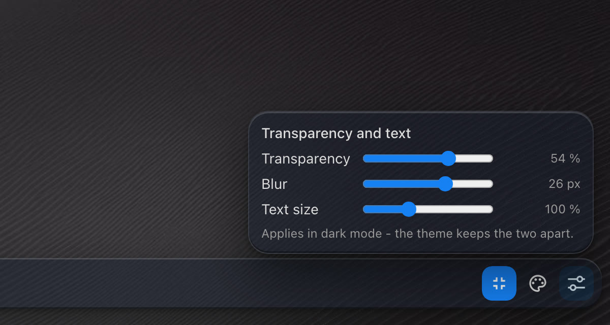
  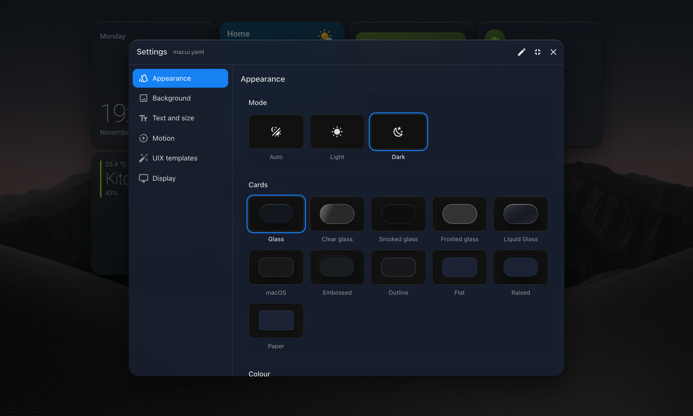
</p>

<p align="center">
  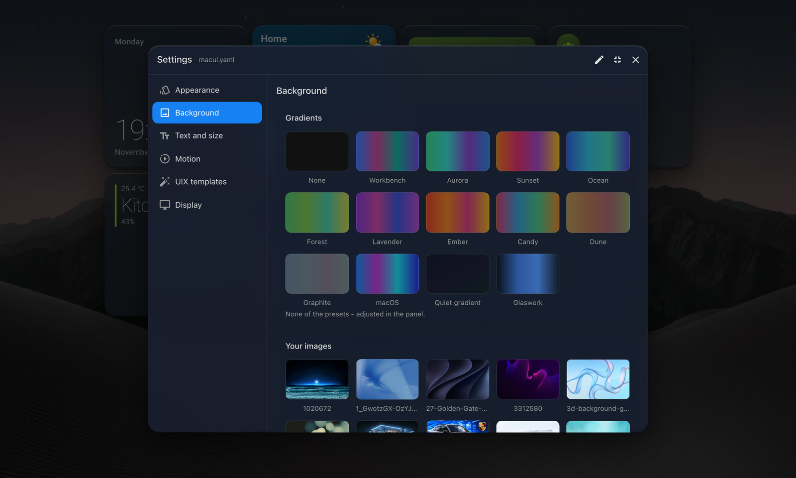
  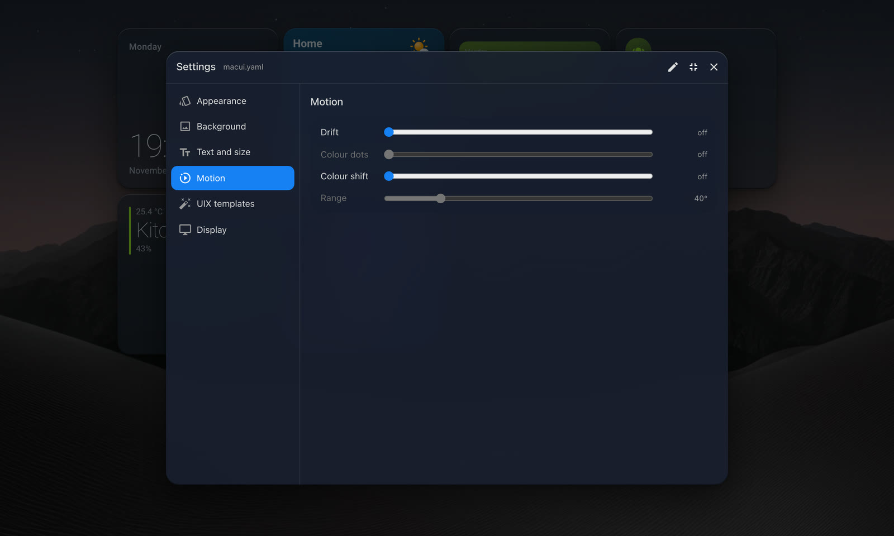
</p>

## Installation

**Via the Marketplace (Home Assistant 2026.11 and later, recommended)**

[](https://my.home-assistant.io/redirect/marketplace_repository/?owner=Piranha1605&repository=glaswerk-styler&category=integration)

1. Click the button above – or Settings → **Marketplace** → **Add from link** → `Piranha1605/glaswerk-styler`
2. Open **Glaswerk** and select **Install**
3. The setup opens by itself afterwards; otherwise Settings → Devices & services → **Add integration** → Glaswerk

The first time, the Marketplace asks you to connect GitHub and to accept the notice for community content.

**Via HACS (Home Assistant 2026.10)**

1. HACS → menu at the top right → **Custom repositories**
2. Add `https://github.com/Piranha1605/glaswerk-styler`, type **Integration**
3. Install **Glaswerk** and restart Home Assistant
4. Settings → Devices & services → **Add integration** → Glaswerk

Coming from HACS to 2026.11 needs nothing from you: Glaswerk moves to the Marketplace automatically and keeps getting updates there.

**Manually**

Copy the `custom_components/glaswerk` folder into `config/custom_components/`, restart Home Assistant and add the integration as above.

**Glaswerk** then appears in the sidebar, and the control bar is in the card picker under **"By card"**, search "Glaswerk". No resource to register – Glaswerk does that itself.

**Languages:** German, English, French, Dutch and Spanish – Glaswerk follows Home Assistant's language; any other language gets English.

**Requires** Home Assistant 2026.10.0 or newer. UI eXtension is only needed for the UIX templates.

## Quick start

1. Open **Glaswerk** in the sidebar
2. **New** or **Open an existing one** – or pick palette, font and card style in the **Kit**
3. **Save** and select the theme in your profile
4. Put the control bar on your dashboard and fine-tune from there

## Reference: control bar

Glaswerk ships a card for dashboards: a bar of buttons. Each one is a target, a
switch or a built-in function — mode, light/dark, fullscreen, weather.

```yaml
type: custom:glaswerk-bar
buttons:
  - name: Home
    icon: mdi:home-outline
    link: /dashboard-home
  - name: Lights
    icon: mdi:ceiling-light-multiple
    link: /dashboard-home/lights
  - entity: light.kitchen         # lit while the lamp is on
    align_end: true
    separator_before: true
  - function: weather
    entity: weather.forecast_home
    align_end: true
  - function: fullscreen
    align_end: true
  - function: mode
    align_end: true
collapse: narrow
```

Without `buttons` it shows mode and fullscreen — the short form.

**Buttons**

| Field | |
|---|---|
| `name`, `icon` | label and icon; one of them is enough |
| `link` | a path changes the view. The pill sits on the button whose target is open |
| `entity` | turns the button into a switch: a tap toggles it, and it is lit while the entity is on |
| `tap_action` | any Home Assistant action; it wins over `link` and over toggling |
| `state_background` | default `true`: a button that is on is filled |
| `light_background` | default `true`: in the lamp's colour, otherwise in Home Assistant's state colour |
| `function` | `mode` (auto/light/dark), `theme` (one button, back and forth), `fullscreen`, `weather`, `motion`, `appearance`, `settings`, `sidebar`, `assist`, `edit` |
| `temperature`, `temperature_source` | `weather` only: a sensor of your own, and whether the value comes from it (`sensor`) or from the weather entity (`weather`) |
| `align_end`, `separator_before` | at the end of the bar; a thin line before it |

**The bar**

It appears in the card picker as soon as the integration is set up and the
page has been reloaded once — on the **"By card"** tab, search for "Glaswerk". The
dialog opens on "By entity", and the card is not listed there: it has no
entity.

There is no resource to register. Glaswerk adds the card to the list under
Settings → Dashboards → Resources itself and removes it again when the
integration is removed. Only if you keep your resources in YAML do you add it
by hand; the log shows the line.

| Field | Default | |
|---|---|---|
| `collapse` | `never` | `narrow` or `always`: the targets move into a list under a menu button. If the bar still does not fit, the buttons at the end follow, starting from the right. With `never` the row scrolls sideways instead |
| `collapse_width` | `500` | with `narrow`: below this **card width**, not window width — and whenever the bar does not fit |
| `menu_shape` | `theme` | `pill` for fully round ends |
| `menu_size` | `normal` | `small`, `normal`, `large` |
| `show_highlight` | `true` | the pill on the current view |
| `kiosk_only` | `false` | `true`: fullscreen in Home Assistant only, the browser window stays |
| `replace_header` | `false` | `true`: on this dashboard the bar replaces Home Assistant's header |
| `placement` | `inline` | `bottom`: the bar floats at the bottom edge above the dashboard and does not scroll with it. In edit mode it sits in the grid again |
| `controls` | `[mode, fullscreen]` | the short form, when there are no `buttons` |

**The background motion** is set by a button with `function: motion`. It
opens four sliders — drift, colour dots, colour shift and range.

The values are permanent: on release the card writes them into the file of the
active theme, using the same functions as the panel. This works for
administrators only, and only for a theme created with Glaswerk; otherwise the
slider says why not.

**Transparency and text size** are set by a button with `function: appearance`,
the same way and under the same conditions.

- **Transparency** (0 to 80 %) changes the card surface. If the theme keeps it
  apart for light and dark, the slider applies to the mode currently shown. If
  the surface is not a plain colour — the "Liquid Glass" card style stores two
  gradients — the slider stays locked. The surface of dialogs and of the
  settings window follows by the same step, so it stays as much more opaque
  than the cards as before — at most fully opaque, and never below 50 %
  opacity, so text on it stays readable.
- **Text size** (90 to 120 %) sets the factor Home Assistant uses for all font
  sizes. Tiles and Mushroom grow with it; the names in Bubble Card stay as they
  are. Above 100 %, tiles cut long names short sooner.

Only the value you moved is written.

**Everything in one window** comes with `function: settings`: one button at
the end of the bar, behind it a settings window modelled on the Mac's System
Settings — sections on the left, choices on the right:

| Section | contains |
|---|---|
| Appearance | mode, card style, colour palette, card transparency and blur |
| Background | the kit's gradients and your own images from `config/www/glaswerk` |
| Text and size | size, typeface, corners |
| Motion | drift, colour dots, colour shift, range |
| UIX templates | every template from the panel with a switch, grouped by cards, interface and background — works only with UI eXtension |
| Display | fullscreen, edit dashboard, theme choice, earlier versions |


Card styles, palettes, typefaces and backgrounds are the parts of the panel's
kit — the same values, written the same way. The window shows which part is in
place. A click writes into the file of the active theme; the version before is
then listed under "Earlier versions" and is back with one click. On a phone the
window fills the screen.

The single functions stay, for a bar that prefers to show them one by one.

**In place of the header** the bar stands with `replace_header: true`. Home
Assistant's header disappears on the dashboard, the bar stays at the top while
scrolling, and it brings what the header had: a sidebar button and — if there
is no settings window — the pencil for editing. In the settings window the
pencil sits at the far right. Assist is available as `function: assist`.

Good to know:

- The bar belongs on **every** view of the dashboard. On a view without it,
  Home Assistant's header is back, so nobody gets stuck.
- In edit mode the header is always there.
- Settings, energy, map and the other pages keep their own header.

The editor lets you add, sort and edit the buttons. Each row shows the
button's name, or without one its target, entity or function.

The fields are those of the menu card from the Horizon Cards. A bar from there
keeps working once `type` is `custom:glaswerk-bar`. Not taken over yet:
`#anchor` links, `hold_action` and `double_tap_action`.

`visibility` works without the card doing anything for it: Home Assistant
evaluates it in its card wrapper, before the card is even built — measured
against HA 2026.10 on 17 Oct 2026. That includes the conditions 2026.10 added:
`template`, `sun`, `zone` and `device`.

### As a badge

The same control exists in a small form, for the badge row above the cards:


```yaml
type: custom:glaswerk-bar-badge
```

The badge is the small control, not the bar: it takes `controls` (`mode`,
`fullscreen`) and `kiosk_only`. Targets, switches and weather belong in the
card. In the badge picker it is listed on the **"By badge"** tab, section
Community badges, as "Glaswerk control".

Everything the card uses is provided by Home Assistant: the elements, the
icons, the colour variables and the two switches behind it. It therefore
follows any theme and needs no further card from HACS.

Worth knowing:

- **The mode belongs to the user, not to the device.** Since 2026.10 Home
  Assistant stores the choice with the user on the server. Switching on the
  wall tablet also switches every other device the same user is logged in on.
- **A theme with only one mode cannot be switched.** The card then locks the
  choice and says why when pressed.
- **Fullscreen means three things.** Home Assistant hides the sidebar (its
  kiosk mode), the card takes the header away, and the browser goes fullscreen
  where it offers that. In edit mode the header stays.
- **Fullscreen is remembered per device.** A wall tablet starts in fullscreen
  again after a reload, as soon as the card is on the view. The same button or
  Esc leads back.

## Backups

Before Glaswerk overwrites a theme file — from the panel or from the control
card — it stores the previous version under `config/glaswerk/sicherungen/<name>/`,
with date and time in the name. The last ten per theme are kept. The file is
written to a helper file first and then renamed in one step; if something
breaks off, the old file stays as it was.

## Relation to HATG

[HATG](https://github.com/Piranha1605/ha-theme-generator) stays in service and keeps being maintained. Glaswerk is the second, simpler way – with its own integration domain, so both can run side by side. One rule: **a theme belongs to one tool.**

## Support

If you like Glaswerk, I'm happy about a coffee:

<p align="center">
  <a href="https://buymeacoffee.com/enricotenif"></a>
</p>

## Licence

MIT
