<p align="center">
  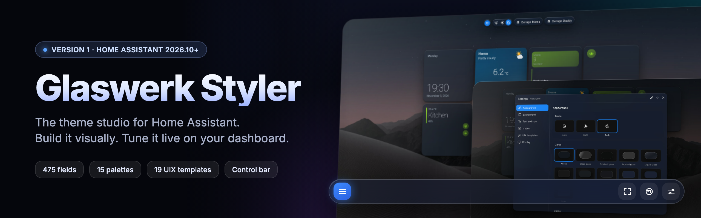
</p>

<p align="center">
  
  
  
  
  
</p>

<p align="center">
  <b>Deutsch</b> · <a href="https://github.com/Piranha1605/glaswerk-styler/blob/main/README.en.md">English</a>
</p>

<p align="center">
  <a href="https://buymeacoffee.com/enricotenif"></a>
</p>

# Glaswerk Styler

**Das Theme-Studio für Home Assistant. Visuell bauen, live im Dashboard verfeinern.**

Glaswerk Styler ist ein eigenes Panel in der Seitenleiste von Home Assistant. Damit baust du ein komplettes Theme, ohne YAML anzufassen – aufgesetzt auf die Farbebene von Home Assistant 2026. Dazu kommt eine Steuerleiste für deine Dashboards: Transparenz, Unschärfe, Schrift, Kartenstil, Palette und Hintergrund stellst du direkt dort ein, wo du sie siehst. Am Ende steht eine ganz normale Theme-Datei.

<p align="center">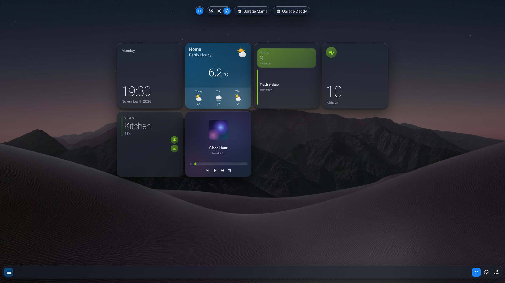</p>

## Video

Glaswerk Styler in 2½ Minuten – vom Studio bis zur Steuerleiste:

<p align="center"><a href="https://youtu.be/_ZQBg-Uf-2A">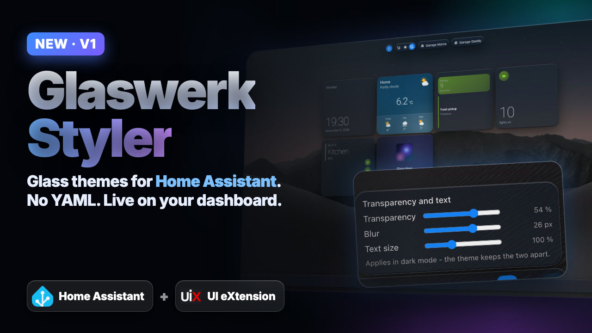</a></p>

## Auf einen Blick

| | |
|---|---|
| **Studio** | Panel in der Seitenleiste: Theme öffnen, ändern, speichern – 475 Felder in acht Stufen |
| **Baukasten** | 15 Farbpaletten, Schriften, Rundung, Dichte, Kartenstile und Hintergründe als fertige Teile |
| **Steuerleiste** | Eine Karte fürs Dashboard: Menü, Vollbild, Einstellungsfenster und Schnellregler |
| **UIX-Vorlagen** | 19 Vorlagen für UI eXtension mit Vorher/Nachher-Vorschau |
| **Bubble Card und Mushroom** | lesen ihre Farben aus derselben Ebene – eine Zuweisung gilt für hell und dunkel |
| **Sicherungen** | Vor jedem Schreiben wird die alte Fassung gesichert, zurück mit einem Klick |

## Das Studio

Das Panel liest jede vorhandene Theme – auch fremde. Was Glaswerk nicht kennt, bleibt unverändert in der Datei. Der Leitsatz: **nur ändern, was man sieht.** Aus 15 Entscheidungen rechnet Home Assistant 51 Füllfarben und 19 Schriftfarben.

<p align="center">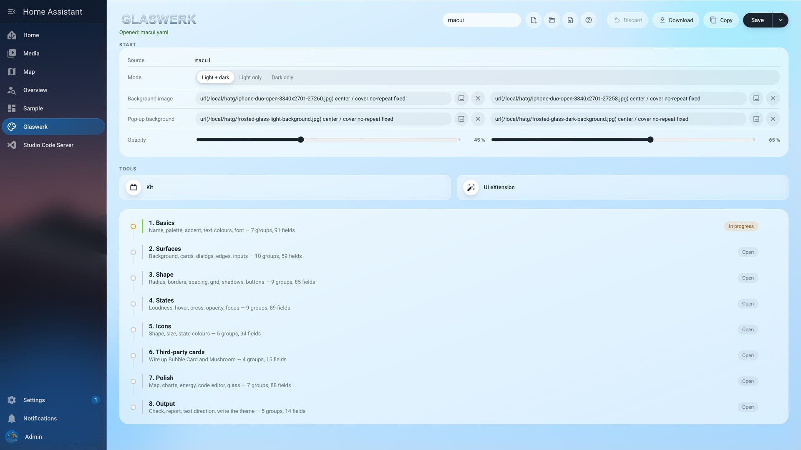</p>

**Baukasten.** Wer nicht bei null anfangen will, steckt eine Theme aus fertigen Teilen zusammen. Fünf Paletten sind übernommen und nachprüfbar: macOS (am System ausgelesen), Android, Nord, Solarized, Catppuccin und Gruvbox.

<p align="center">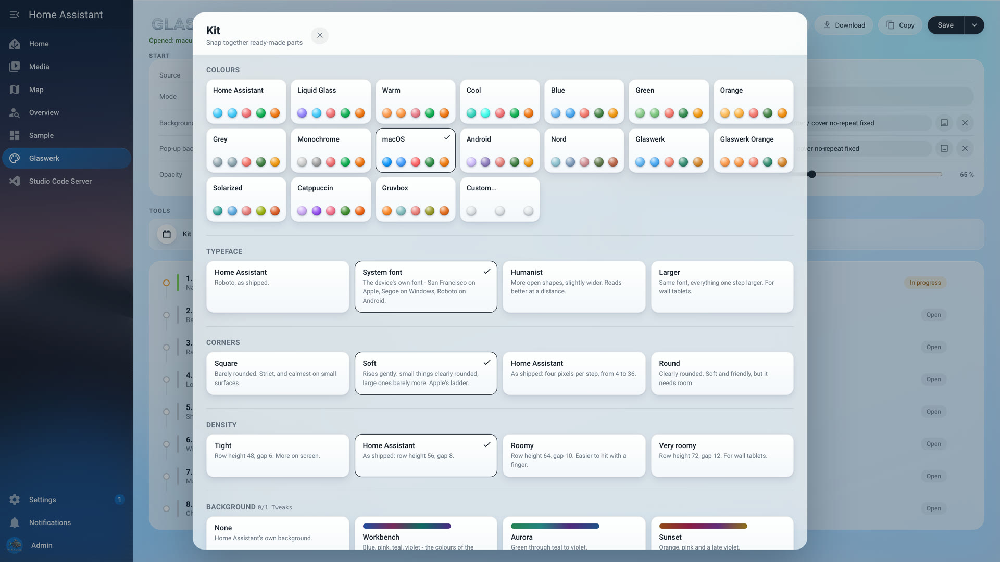</p>

**Acht Stufen.** Grundlagen, Flächen, Form, Zustände, Symbole, fremde Karten, Feinschliff und Ausgabe – jede Gruppe mit einem Satz, wozu sie da ist.

<p align="center">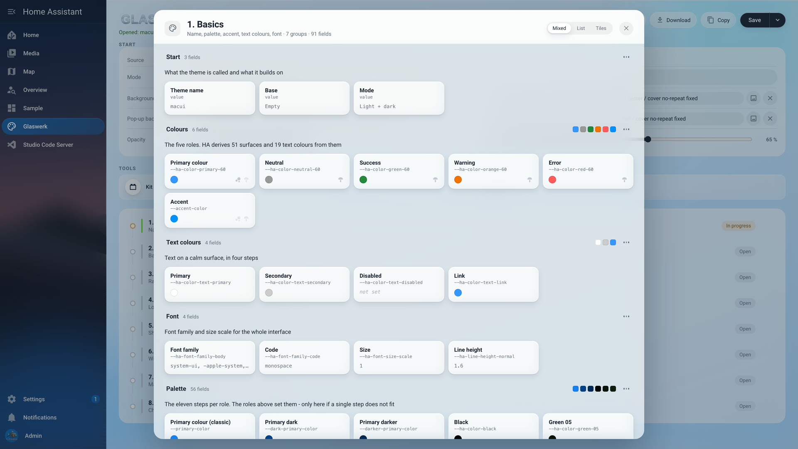</p>

**UI eXtension.** Für alles, was eine Regel braucht statt eines Werts: Glas auf Karten, Lichtkante, Seitenleiste in Glas, leuchtende und schlanke Regler. Jede Vorlage zeigt Vorher und Nachher an derselben Stelle.

<p align="center">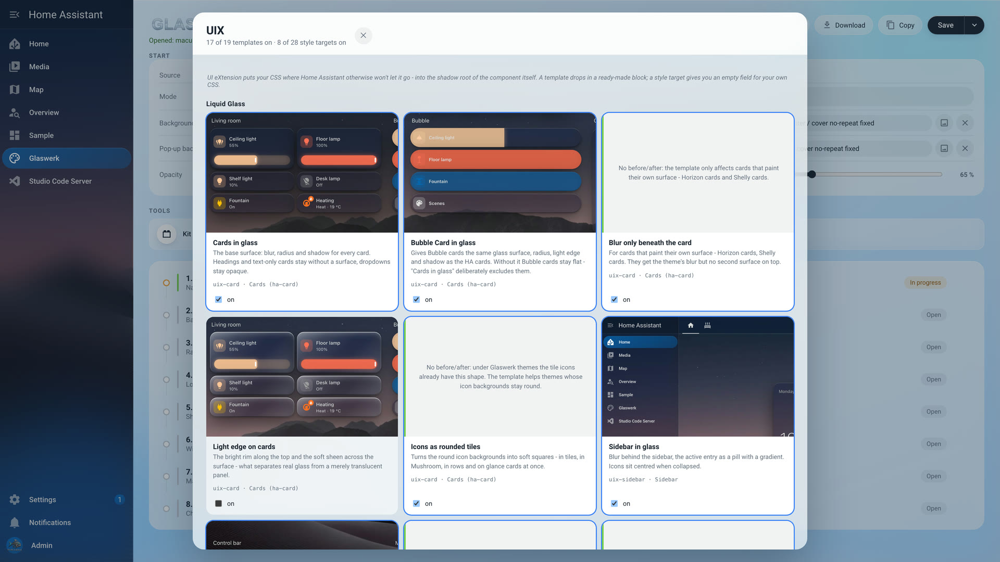</p>

## Die Steuerleiste

Eine Karte für dein Dashboard. Sie schwebt am unteren Rand, und jede Änderung landet sofort in der Theme-Datei.

<p align="center">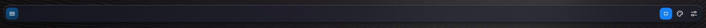</p>

- **Menü** mit allen Ansichten des Dashboards
- **Vollbild** fürs Wandtablett – wird je Gerät gemerkt
- **Schnellregler** für Transparenz, Unschärfe und Schriftgröße
- **Einstellungsfenster** im Stil der Mac-Systemeinstellungen: Erscheinungsbild, Hintergrund, Schrift und Größe, Bewegung, UIX-Vorlagen, Anzeige mit früheren Fassungen

<p align="center">
  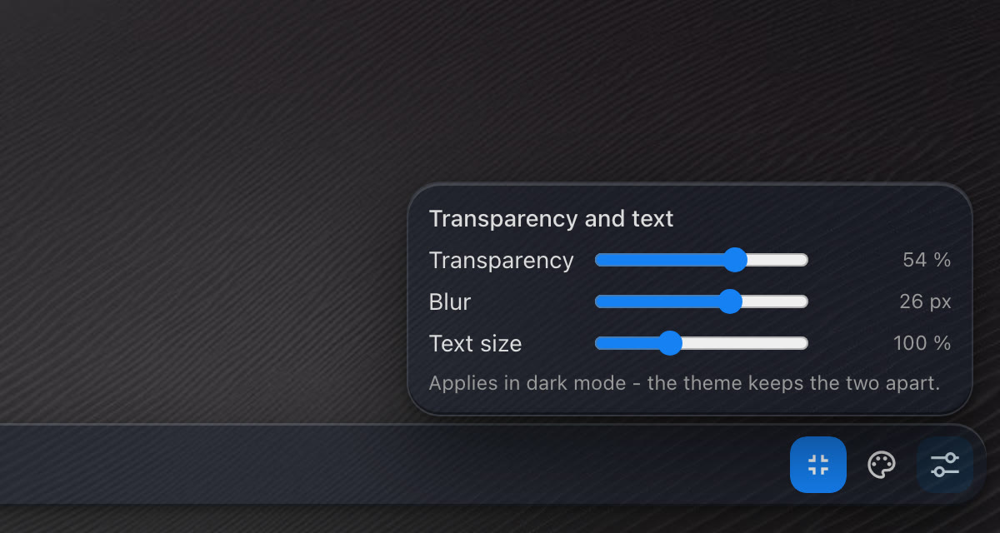
  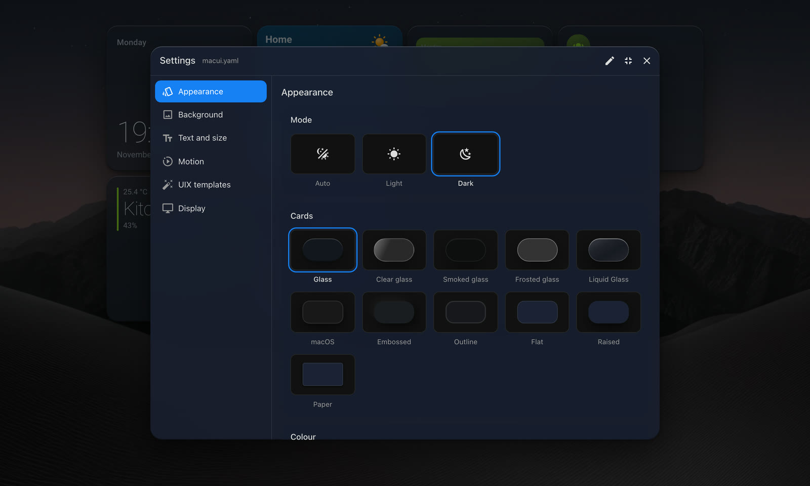
</p>

<p align="center">
  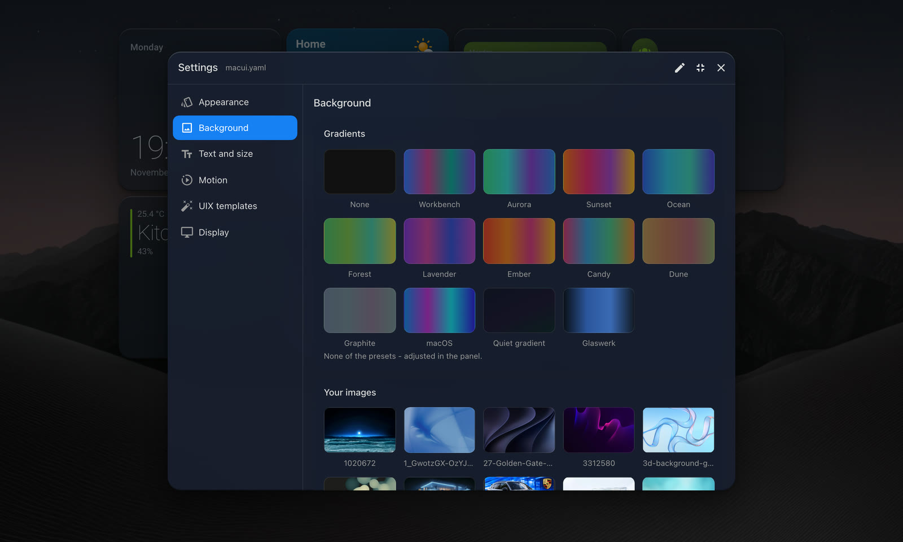
  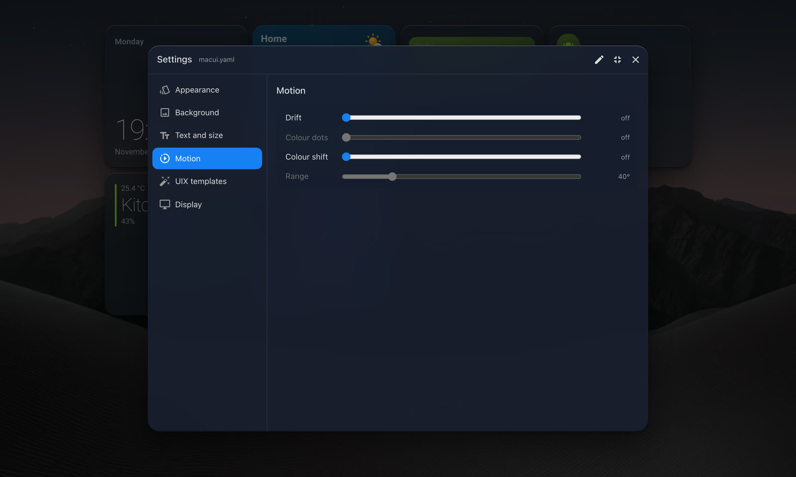
</p>

## Installation

**Über HACS (empfohlen)**

1. HACS → Menü oben rechts → **Benutzerdefinierte Repositories**
2. `https://github.com/Piranha1605/glaswerk-styler` eintragen, Typ **Integration**
3. **Glaswerk** installieren und Home Assistant neu starten
4. Einstellungen → Geräte & Dienste → **Integration hinzufügen** → Glaswerk

**Von Hand**

Den Ordner `custom_components/glaswerk` nach `config/custom_components/` kopieren, Home Assistant neu starten und die Integration wie oben hinzufügen.

Danach steht **Glaswerk** in der Seitenleiste, und die Steuerleiste findest du im Kartenwähler unter **„Nach Karte"**, Suche „Glaswerk". Eine Ressource musst du nicht eintragen – Glaswerk macht das selbst.

**Sprachen:** Deutsch, Englisch, Französisch, Niederländisch und Spanisch – Glaswerk folgt der Sprache von Home Assistant, alle anderen Sprachen bekommen Englisch.

**Voraussetzung:** Home Assistant 2026.10.0 oder neuer. UI eXtension ist nur für die UIX-Vorlagen nötig.

## Schnellstart

1. **Glaswerk** in der Seitenleiste öffnen
2. **Neu** oder **Vorhandene öffnen** – oder im **Baukasten** Palette, Schrift und Kartenstil wählen
3. **Speichern** und die Theme im Profil auswählen
4. Die Steuerleiste aufs Dashboard legen und ab jetzt dort feinstellen

## Referenz: Steuerleiste

Glaswerk bringt eine Karte für Dashboards mit: eine Leiste aus Knöpfen. Jeder ist
ein Ziel, ein Schalter oder eine eingebaute Funktion — Modus, Hell/Dunkel,
Vollbild, Wetter.

```yaml
type: custom:glaswerk-bar
buttons:
  - name: Home
    icon: mdi:home-outline
    link: /dashboard-home
  - name: Licht
    icon: mdi:ceiling-light-multiple
    link: /dashboard-home/licht
  - entity: light.kueche          # leuchtet, solange die Lampe an ist
    align_end: true
    separator_before: true
  - function: weather
    entity: weather.forecast_home
    align_end: true
  - function: fullscreen
    align_end: true
  - function: mode
    align_end: true
collapse: narrow
```

Ohne `buttons` zeigt sie Modus und Vollbild — die kurze Form.

**Knöpfe**

| Feld | |
|---|---|
| `name`, `icon` | Beschriftung und Symbol; eins von beiden genügt |
| `link` | ein Pfad wechselt die Ansicht. Die Kapsel sitzt auf dem Knopf, dessen Ziel offen ist |
| `entity` | macht den Knopf zum Schalter: Antippen schaltet um, und er leuchtet, solange sie an ist |
| `tap_action` | jede Aktion von Home Assistant; sie schlägt `link` und das Umschalten |
| `state_background` | Vorgabe `true`: ein eingeschalteter Knopf wird gefüllt |
| `light_background` | Vorgabe `true`: in der Farbe der Lampe, sonst in Home Assistants Zustandsfarbe |
| `function` | `mode` (automatisch/hell/dunkel), `theme` (ein Knopf, hin und her), `fullscreen`, `weather`, `motion`, `appearance`, `settings`, `sidebar`, `assist`, `edit` |
| `temperature`, `temperature_source` | nur bei `weather`: eigener Sensor, und ob der Wert von dort (`sensor`) oder aus der Wetterentität (`weather`) kommt |
| `align_end`, `separator_before` | ans Ende der Leiste; dünner Strich davor |

**Die Leiste**

Sie steht im Kartenwähler, sobald die Integration eingerichtet und die Seite
einmal neu geladen ist — unter dem Reiter **„Nach Karte"**, Suche „Glaswerk". Der
Dialog öffnet auf „Nach Entität", und dort steht sie nicht: Sie hat keine
Entität.

Eine Ressource muss niemand eintragen. Glaswerk trägt die Karte selbst in die Liste
unter Einstellungen → Dashboards → Ressourcen ein und nimmt sie wieder heraus,
wenn die Integration entfernt wird. Nur wer seine Ressourcen in YAML führt,
trägt sie von Hand ein; die Zeile dafür steht im Log.

| Feld | Vorgabe | |
|---|---|---|
| `collapse` | `never` | `narrow` oder `always`: die Ziele wandern in eine Liste unter einem Menüknopf. Passt die Leiste dann noch nicht, folgen die Knöpfe am Rand, vom rechten Ende her. Mit `never` rollt die Reihe stattdessen seitlich |
| `collapse_width` | `500` | bei `narrow`: unter dieser **Kartenbreite**, nicht Fensterbreite — und immer, wenn die Leiste nicht passt |
| `menu_shape` | `theme` | `pill` für ganz runde Enden |
| `menu_size` | `normal` | `small`, `normal`, `large` |
| `show_highlight` | `true` | die Kapsel auf der aktuellen Ansicht |
| `kiosk_only` | `false` | `true`: Vollbild nur in Home Assistant, das Browserfenster bleibt |
| `replace_header` | `false` | `true`: die Leiste ersetzt auf diesem Dashboard die Kopfzeile von Home Assistant |
| `placement` | `inline` | `bottom`: die Leiste schwebt am unteren Rand über dem Dashboard und rollt nicht mit. Im Bearbeitungsmodus steht sie wieder im Raster |
| `controls` | `[mode, fullscreen]` | die kurze Form, wenn es keine `buttons` gibt |

**Die Bewegung des Hintergrunds** stellt ein Knopf mit `function: motion`. Er
klappt vier Regler auf — Treiben, Farbpunkte, Farbwechsel und Ausschlag.

Die Werte gelten dauerhaft: Die Karte schreibt sie beim Loslassen in die Datei
der wirksamen Theme, mit denselben Funktionen wie das Panel. Das geht nur als
Administrator und nur bei einer Theme, die mit Glaswerk erzeugt wurde; sonst sagt
der Regler, warum nicht.

**Transparenz und Schrift** stellt ein Knopf mit `function: appearance`, auf
dieselbe Weise und mit denselben Bedingungen.

- **Transparenz** (0 bis 80 %) ändert die Kartenfläche. Steht sie in der Theme
  für hell und dunkel getrennt, gilt der Regler für den Modus, der gerade
  angezeigt wird. Ist die Fläche keine einfache Farbe — der Kartenstil „Liquid
  Glass" legt zwei Verläufe ab —, bleibt der Regler gesperrt. Die Fläche der
  Dialoge und des Einstellungsfensters zieht um denselben Schritt mit, bleibt
  also so viel deckender als die Karten wie vorher — höchstens ganz deckend,
  und nie unter 50 % Deckkraft, damit Text darauf lesbar bleibt.
- **Schrift** (90 bis 120 %) setzt den Faktor, mit dem Home Assistant alle
  Schriftgrößen rechnet. Kacheln und Mushroom wachsen mit; die Namen in Bubble
  Card bleiben, wie sie sind. Über 100 % kürzen Kacheln lange Namen früher ab.

Geschrieben wird nur der Wert, an dem gezogen wurde.

**Alles in einem Fenster** gibt es mit `function: settings`: ein Knopf am Rand
der Leiste, dahinter ein Einstellungsfenster nach dem Vorbild der
Systemeinstellungen am Mac — links die Bereiche, rechts die Auswahl:

| Bereich | darin |
|---|---|
| Erscheinungsbild | Modus, Kartenstil, Farbpalette, Transparenz und Weichzeichnung der Karten |
| Hintergrund | die Farbverläufe des Baukastens und eigene Bilder aus `config/www/glaswerk` |
| Schrift und Größe | Größe, Schriftart, Rundung |
| Bewegung | Treiben, Farbpunkte, Farbwechsel, Ausschlag |
| UIX-Vorlagen | jede Vorlage aus dem Panel mit Schalter, nach Karten, Oberfläche und Hintergrund — wirkt nur mit UI eXtension |
| Anzeige | Vollbild, Dashboard bearbeiten, Wahl der Theme, frühere Fassungen |


Kartenstile, Paletten, Schriften und Hintergründe sind die Teile des
Baukastens aus dem Panel — dieselben Werte, dieselbe Art zu schreiben. Das
Fenster zeigt an, welches Teil gerade sitzt. Ein Klick schreibt in die Datei
der wirksamen Theme; die Fassung davor liegt danach unter „Frühere Fassungen"
und ist mit einem Klick zurück. Am Telefon füllt das Fenster den Bildschirm.

Die einzelnen Funktionen bleiben, für eine Leiste, die sie lieber einzeln
zeigt.

**An Stelle der Kopfzeile** steht die Leiste mit `replace_header: true`. Home
Assistants Kopfzeile verschwindet auf dem Dashboard, die Leiste bleibt beim
Rollen oben, und sie bringt mit, was die Kopfzeile hatte: einen Knopf für die
Seitenleiste und — wenn kein Einstellungsfenster da ist — den Stift zum
Bearbeiten. Im Einstellungsfenster steht der Stift ganz rechts. Assist
gibt es als `function: assist`.

Zu wissen:

- Die Leiste gehört auf **jede** Ansicht des Dashboards. Auf einer Ansicht
  ohne sie ist Home Assistants Kopfzeile wieder da, damit niemand festsitzt.
- Im Bearbeitungsmodus ist die Kopfzeile immer da.
- Einstellungen, Energie, Karte und die übrigen Seiten behalten ihre eigene
  Kopfzeile.

Im Editor lassen sich die Knöpfe anlegen, sortieren und bearbeiten. Jede Zeile
nennt den Knopf beim Namen, und ohne Namen beim Ziel, der Entität oder der
Funktion.

Die Felder sind die der Menü-Karte aus den Horizon-Cards. Eine Leiste von dort
läuft weiter, wenn `type` auf `custom:glaswerk-bar` steht. Noch nicht
übernommen sind `#anker`-Links, `hold_action` und `double_tap_action`.

`visibility` dagegen wirkt, ohne dass die Karte etwas dafür tut: Home Assistant
wertet es in seiner Kartenhülle aus, bevor die Karte gebaut wird — am 17.10.2026
an HA 2026.10 nachgemessen. Damit gelten auch die Bedingungen, die 2026.10 neu
gebracht hat: `template`, `sun`, `zone` und `device`.

### Als Badge

Dieselbe Steuerung gibt es in klein, für die Badge-Reihe über den Karten:


```yaml
type: custom:glaswerk-bar-badge
```

Das Badge ist die kleine Steuerung, nicht die Leiste: Es kennt `controls`
(`mode`, `fullscreen`) und `kiosk_only`. Ziele, Schalter und Wetter gehören in
die Karte. Im Badge-Wähler steht es unter **„Nach Badge"**, Abschnitt
Community-Badges, als „Glaswerk Steuerung".

Alles, was die Karte benutzt, stellt Home Assistant: die Bauteile, die Symbole,
die Farbvariablen und die beiden Schalter dahinter. Sie passt sich deshalb jeder
Theme an und braucht keine weitere Karte aus HACS.

Was man wissen sollte:

- **Der Modus gilt für den Nutzer, nicht für das Gerät.** Home Assistant legt
  die Wahl seit 2026.10 beim Nutzer auf dem Server ab. Wer auf dem Wandtablett
  umschaltet, schaltet auch jedes andere Gerät um, an dem derselbe Nutzer
  angemeldet ist.
- **Eine Theme mit nur einem Modus lässt sich nicht umschalten.** Die Karte
  sperrt die Wahl dann und sagt beim Drücken, warum.
- **Vollbild heißt dreierlei.** Home Assistant blendet die Seitenleiste aus
  (sein Kiosk-Modus), die Karte nimmt die Kopfzeile weg, und der Browser geht
  ins Vollbild, wo er das anbietet. Im Bearbeitungsmodus bleibt die Kopfzeile.
- **Das Vollbild wird je Gerät gemerkt.** Ein Wandtablett startet nach dem
  Neuladen wieder im Vollbild, sobald die Karte auf der Ansicht steht. Zurück
  geht es über denselben Knopf oder mit Esc.

## Sicherungen

Bevor Glaswerk eine Theme-Datei überschreibt — aus dem Panel oder aus der
Steuerkarte —, legt es die bisherige Fassung unter
`config/glaswerk/sicherungen/<name>/` ab, mit Datum und Uhrzeit im Namen. Je Theme
bleiben die letzten zehn. Geschrieben wird erst in eine Hilfsdatei und dann in
einem Schritt umbenannt; bricht etwas ab, steht die alte Datei unverändert da.

## Verhältnis zu HATG

[HATG](https://github.com/Piranha1605/ha-theme-generator) bleibt in Betrieb und wird weiter gepflegt. Glaswerk ist der zweite, einfachere Weg – mit eigener Integrations-Domain, damit beide nebeneinander laufen können. Eine Regel: **eine Theme gehört einem Werkzeug.**

## Unterstützen

Wenn dir Glaswerk gefällt, freue ich mich über einen Kaffee:

<p align="center">
  <a href="https://buymeacoffee.com/enricotenif"></a>
</p>

## Lizenz

MIT
